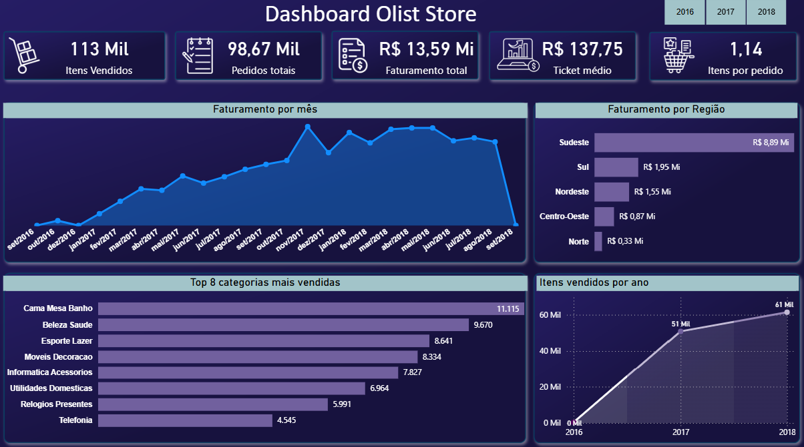
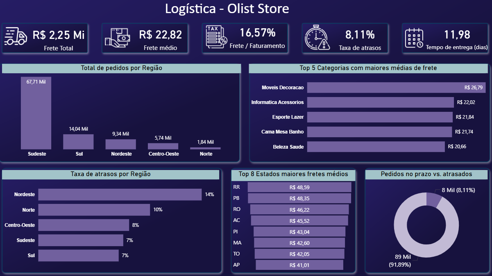
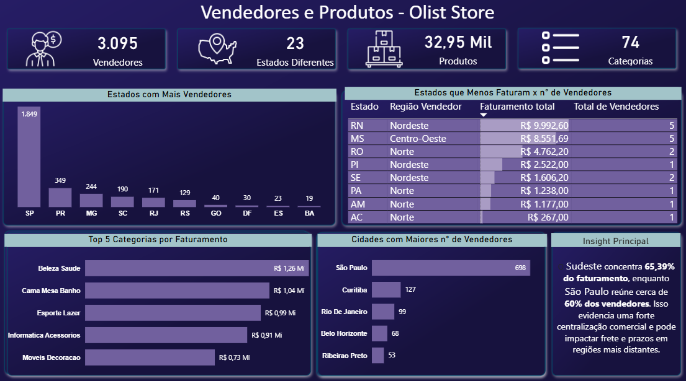

# 📊 Análise Comercial e Logística — Olist Marketplace (E-Commerce Brasil)

## 📌 Visão Geral do Projeto
Este projeto tem como objetivo diagnosticar o desempenho comercial, a eficiência logística e a estrutura da malha de vendedores do ecossistema de e-commerce brasileiro com base nos dados públicos da Olist (2016 a 2018).
(Os dados brutos foram extraídos de arquivos CSV públicos da Olist (via Kaggle) e importados para tratamento e modelagem no Power BI.)

Mais do que a construção de dashboards visuais, o foco deste trabalho foi responder a perguntas críticas de negócio:
- Onde estão os gargalos operacionais que afetam os prazos de entrega e a experiência do cliente?
- Qual é a dimensão do impacto financeiro do frete sobre a receita em diferentes regiões do país?
- Como a concentração geográfica de sellers influencia a logística interestadual?

---

## 🎯 Principais Indicadores (KPIs)
- **Faturamento Total:** R$ 13,59 Milhões
- **Volume de Pedidos Únicos:** 98,67 Mil pedidos
- **Total de Itens Comercializados:** 113 Mil itens
- **Ticket Médio por Pedido:** R$ 137,75
- **Média de Itens por Pedido:** 1,14 itens
- **Taxa Média de Atraso Global:** 8,11% (de 89 mil entregas concluídas)
- **Custo Médio de Frete por Pedido:** R$ 22,82 (16,57% sobre o faturamento total)

---

## 🔍 Diagnóstico e Insights de Negócio

### 1. Hipercentralização da Cadeia de Suprimentos
- **Origem (Vendedores):** O estado de São Paulo reúne cerca de **60% de todos os vendedores ativos** do marketplace (1.849 de 3.095), com a capital paulista concentrando isoladamente 698 vendedores.
- **Destino (Faturamento):** A região Sudeste responde por **65,39% da receita**, enquanto o Sul representa 14,38%. Regiões como Centro-Oeste (6,40%) e Norte (2,46%) possuem baixa participação comercial.

### 2. A Penalização Logística do Norte e Nordeste
- **Taxas de Atraso:** Enquanto Sudeste e Sul mantêm taxas de atraso controladas em torno de **7%**, o Nordeste atinge **14%** e o Norte **10%**.
- **Custo de Frete:** Os 8 estados com maiores médias de frete pertencem exclusivamente às regiões Norte e Nordeste (RR, PB, RO, AC, PI, MA, TO e AP), com fretes médios oscilando entre R$ 41,00 e R$ 48,59 por pedido — mais que o dobro da média nacional (R$ 22,82).
- **Causa Operacional:** A ausência de vendedores e centros de distribuição locais nessas regiões força a transferência de mercadorias em longas distâncias rodoviárias a partir de SP/PR, inflando fretes e degradando o SLA de entrega.

### 3. Divergência entre Volume e Receita por Categoria
- **Volume:** A categoria líder em quantidade de itens vendidos é *Cama, Mesa e Banho* (11.115 itens), seguida por *Beleza e Saúde* (9.670 itens).
- **Receita Líquida:** No ranking de faturamento, *Beleza e Saúde* assume a liderança (R$ 1,26 Mi), superando *Cama, Mesa e Banho* (R$ 1,04 Mi) devido ao seu maior ticket médio por produto.

---

## 💡 Recomendações Estratégicas para o Negócio
1. **Atração de Vendedores Regionais (Descentralização de Estoque):** Criar programas de incentivos comerciais — como redução temporária nas taxas de comissão cobradas pela plataforma — para atrair lojistas qualificados no Nordeste (PE, BA, CE) e Norte (PA, AM), encurtando a distância até o consumidor final.
2. **Políticas de Frete Compartilhado / Subsídio:** Para rotas onde o frete ultrapassa 25% do valor do produto, testar campanhas de frete fixo ou subsídio parcial (dividindo o custo entre plataforma, vendedor e cliente) focado em itens leves e de alto giro, como a categoria de Beleza e Saúde.
3. **Recalibração dos Prazos Estimados (SLA de Transporte):** Revisar o algoritmo de cálculo de prazo exibido no carrinho para clientes do Norte e Nordeste. A taxa de atraso de 14% indica que as estimativas atuais estão otimistas demais para rotas interestaduais de longa distância.
---

## 🛠️ Como os Dados Foram Estruturados (Bastidores Técnicos)

- **Cuidado com a duplicação de dados:** Garanti que a análise separasse corretamente o que é "pedido único" e o que é "item do pedido". Sem essa trava, um cliente que comprou três produtos de uma vez faria o pedido ser contado três vezes, o que inflaria artificialmente a receita e distorceria o frete médio.
- **Organização do Modelo de Dados:** Em vez de juntar tudo num "tabelão" único (o que deixa o arquivo pesado e gera erros), estruturei o projeto separando as movimentações financeiras (as vendas em si) das tabelas de cadastro (clientes, vendedores, produtos e calendário). Isso evitou conflitos na hora de cruzar os estados dos clientes com os estados dos vendedores.
- **Cálculos (DAX) alinhados à realidade da operação:** As fórmulas foram construídas respeitando as regras do negócio. Por exemplo, criei travas para garantir que o cálculo de tempo de entrega e taxa de atrasos considerasse apenas os pedidos com status de "entregue", ignorando compras canceladas ou datas em branco que poderiam quebrar as métricas.
---

## 🖥️ Estrutura do Dashboard
- **Página 1 — Visão Geral:** Faturamento mensal contínuo, sazonalidade, ticket médio e distribuição regional de vendas.
- **Página 2 — Logística:** Indicadores de frete, tempo médio de entrega e comparação regional de atrasos.
- **Página 3 — Vendedores e Produtos:** Concentração de fornecedores por estado/cidade, análise de categorias e desempenho dos menores polos comerciais.

  ### Página 1 — Visão Geral

### Página 2 — Logística

### Página 3 — Vendedores e Produtos

